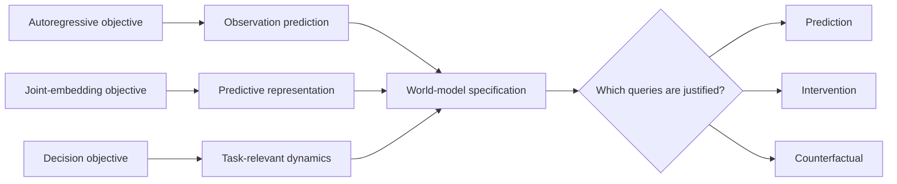

## One name, several different models

A video generator that predicts the next frame is a *world model*. A network that predicts the next embedding is also a *world model*. So is a simulator used by an agent to choose its next action. All three can be powerful, but do they know the same things about the world?

The term has travelled from recurrent latent dynamics and imagination-based control <d-cite key="ha2018world,hafner2023mastering"></d-cite>, through model-based planning <d-cite key="schrittwieser2020mastering,hansen2024tdmpc"></d-cite>, to joint-embedding prediction and video representation learning <d-cite key="lecun2022path,assran2025vjepa2,zhou2025dinowm"></d-cite>. Their common ambition is to capture regularities that help anticipate the future. Their *learning objectives*, internal variables, and supported questions are not the same.

This matters when a model moves beyond plausible prediction. Suppose a robot watches a cup slide across a table. Can it predict the next image? Can it predict where the cup will go *if pushed*? After a failed push, can it say what would have happened under a different push **in the same episode**? These questions look similar in a demo; they require different information.

We need not impose a single architecture on every world model. We do need a common way to specify **what is represented, what is learned, and which questions the evidence can justify**.

## Three learning signals, three different pressures

Many contemporary approaches can be understood through three overlapping—not mutually exclusive—learning signals.

| Learning signal | Representative systems | What it encourages | What it does **not** establish by itself |
| :--- | :--- | :--- | :--- |
| **Predict observations** | Autoregressive video/language prediction, generative dynamics <d-cite key="ha2018world"></d-cite> | Regularities useful for predicting the next token, frame, or observation | Unique objects, causal mechanisms, or intervention effects |
| **Predict representations** | JEPA, V-JEPA, DINO-WM, LeJEPA <d-cite key="lecun2022path,assran2025vjepa2,zhou2025dinowm,balestriero2025lejepa"></d-cite> | Stable, predictive latent features and selected invariances | That the features correspond to identifiable causal variables |
| **Learn for decisions** | Dreamer, MuZero, TD-MPC2 <d-cite key="hafner2023mastering,schrittwieser2020mastering,hansen2024tdmpc"></d-cite> | State distinctions useful for evaluating actions and policies | A complete physical description or all counterfactual answers |

Three learning signals inform different components of a world model. Causal guarantees require additional evidence and assumptions; no learning objective alone certifies them.

These are *pressures*, not mutually exclusive categories. A model can predict latent states, use actions, and optimise a policy simultaneously. The distinction is between an **objective that encourages a property** and an **assumption or theorem that guarantees it**.

Autoregressive learning can capture persistence and dynamics because such regularities help prediction. But the same observable sequence may admit several latent explanations: unsupervised representation recovery is not unique without additional assumptions <d-cite key="locatello2019challenging,khemakhem2020variational"></d-cite>.

Joint-embedding objectives move prediction into feature space. An encoder may be trained to ignore some transformations (*invariance*) while tracking others predictably (*equivariance*). Which variables survive depends on the chosen transformations, data, and architecture. Even recent identifiability results for embedding methods rely on specific data-generating assumptions; they are not generic guarantees that a causal graph has been recovered <d-cite key="klindt2026when"></d-cite>.

Decision-oriented learning can deliberately discard details irrelevant to the current task. A state sufficient for choosing an action need not name every object or explain every disturbance. This is a feature, not a failure—until we reuse it for a different task that needs precisely those discarded distinctions <d-cite key="grimm2020value"></d-cite>.

**The objective tells us what a model is rewarded for learning. It does not tell us everything the resulting representation means.**

## A small specification that connects them

A useful shared description begins with an observation $x_t$, an action $a_t$, and an internal state $r_t$ representing the information the model retains about its environment. For *structured* models, $r_t$ may include entities, their attributes, and relations such as contact or relative position. For other models it may remain an opaque latent vector.

We can write a candidate world model as

$$
W=(\mathcal X,\mathcal A,\mathcal R,P,U),
$$

where $\mathcal X$ is the observation space, $\mathcal A$ the action space, $\mathcal R$ a declared state space, $P$ the probabilistic model connecting observations, states, and actions, and $U$ the task utility. For entity-based models, the state space may depend on the entities present and must respect any declared relational constraints.

Under suitable conditional-independence and state-sufficiency assumptions, one familiar predictive interface is

$$
p(x_{t+1}\mid x_t,a_t)
=\iint \underbrace{p(x_{t+1}\mid r_{t+1})}_{\text{prediction}}
\underbrace{p(r_{t+1}\mid r_t,a_t)}_{\text{transition}}
\underbrace{p(r_t\mid x_t)}_{\text{inference}}
\,dr_t\,dr_{t+1}.
$$

This is **one structured factorisation, not a universal neural-network architecture**. Some predictors work directly in observation space; some use histories rather than a single $x_t$; some never decode pixels. A logged action may even reveal hidden state information unavailable in $x_t$, requiring $p(r_t\mid x_t,a_t)$ rather than the inference term shown above. The point is to declare interfaces and assumptions instead of hiding them under the label *world model*.

The three learning signals can now be located within the same specification: an autoregressive loss evaluates observation predictions; a JEPA-like loss evaluates predictions in representation space; and a decision objective evaluates imagined trajectories or selected actions. None of these losses is identical to the *environmental utility* $U$, and none alone supplies causal semantics.

## What makes the model causal?

A predictive transition $p(r_{t+1}\mid r_t,a_t)$ is an association learned under some action-selection process. A causal action effect asks about actively setting an action:

$$
p(r_{t+1}\mid r_t,\operatorname{do}(a_t=a')).
$$

The two can agree under suitable conditions—for example, consistency, adequate action coverage, and no unmeasured confounding after conditioning on the declared history—but they are not equal by notation alone <d-cite key="pearl2009causality,hernan2020whatif"></d-cite>.

A third question is harder: *after seeing what happened, what would have happened if I had acted differently in that very event?* This is an **individual counterfactual**. It requires a correspondence between alternative outcomes under the same underlying disturbance, not just an action-conditioned distribution.

An instructive recent example is *Counterfactual World Models: JEPAs That Reason About “What If”* <d-cite key="balestriero2026counterfactual"></d-cite>. Imagine a boat whose observed trajectory is affected by an unseen current. The authors show that even exact factual action-conditioned distributions do not, in general, identify the alternative trajectory under that **same** current. They then use additional physical assumptions: where actions and disturbances act through separate channels, a residual from the observed outcome can be transported across actions. The approximation has explicit guarantees for short, sufficiently smooth transitions—and explicit failure modes at contacts, unsuitable coordinates, or multiplicative disturbances.

That is a concrete lesson about the word *causal*: the capability comes from the **query plus its identification assumptions**, not from calling a JEPA or simulator a causal model.

A convenient way to express this is through *query-relative equivalence*. Let $\mathcal Q$ be the questions we care about (perhaps next-frame predictions, policy values, interventions, or individual counterfactuals). Define

$$
W_1\sim_{\mathcal Q}W_2
\quad\Longleftrightarrow\quad
q(W_1)=q(W_2)\ \text{for every }q\in\mathcal Q.
$$

Two models need not share latent coordinates to be equally useful for a query. Conversely, two models can agree on every observed prediction and still disagree on a counterfactual. **Identifiability is therefore not simply “did we recover the model?” but “which answers are fixed by the evidence, up to what ambiguity?”**

## Even correct components can disagree

A final obstacle arises when models are assembled. An object encoder may identify objects only up to a permutation. A relation module may use a rescaled interaction variable. A policy may assume fixed identities and an unscaled interface. Each component can be valid in its own coordinates while the assembled system acts on the wrong object.

This resembles the counterfactual problem above, but it is **not the same theorem**. The counterfactual problem asks whether alternative outcomes can be matched across actions. The composition problem asks whether local representational ambiguities admit a *common alignment* across state, action, dynamics, and utility. Under compatible alignments, finite-horizon behaviour can be preserved; separate component guarantees alone do not supply those alignments.

A causal world model intended for reuse must thus state not only what its parts recover, but **which transformations preserve the meanings at their interfaces**. Work on state abstraction and causal abstraction provides related foundations <d-cite key="grimm2020value,rubenstein2017causal"></d-cite>.

## A more useful checklist

Rather than asking whether a system *is* a world model, ask:

1. **Representation:** What state, entities, or relations does it retain? Which changes leave that representation unchanged?
2. **Learning signal:** Is it trained to predict observations, predict embeddings, or support decisions—and from what evidence?
3. **Action semantics:** Are actions observed correlations, controlled interventions, or both?
4. **Identifiability:** Which predictions, policy values, interventions, or counterfactuals are determined by the evidence and assumptions?
5. **Reuse:** Do separately learned components preserve those answers when connected?

This is not a demand that every video predictor become a full structural causal model. A predictive world model is a valid and useful object. A control-oriented world model may need only task-relevant distinctions. But the adjective **causal** should carry an explicit commitment: specify the causal questions, the mechanisms or assumptions that give interventions meaning, and the limits of what can be identified.

**Perhaps the most useful formal definition of a causal world model is not a particular architecture. It is a structured model together with a precise account of the causal queries its components can—and cannot—justify.**
