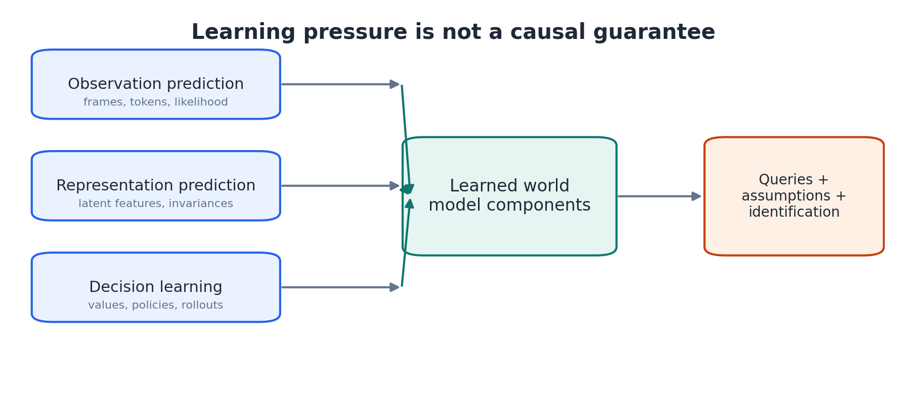
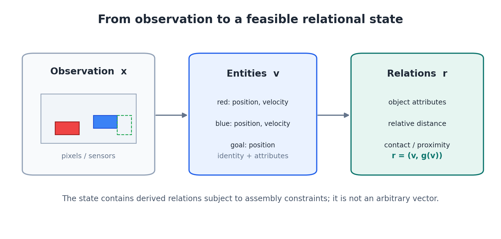
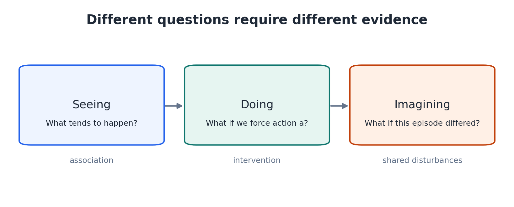

## What are world models?

An agent rarely gets to try every possible action before making a decision. It must anticipate how its environment might change, often from incomplete observations. A **world model** is an internal model of environmental regularities that supports such anticipation: predicting what might happen next, simulating possible consequences, or supplying information for planning. The idea is longstanding in model-based reinforcement learning and has taken new forms in learned visual and latent dynamics <d-cite key="moerland2023model,ha2018world,hafner2023mastering,lecun2022path"></d-cite>.

There is no single required architecture. Some models predict observations, including video frames or tokens; some predict compressed representations; others learn action-conditioned transitions or planning-relevant quantities without reconstructing the visible world <d-cite key="ha2018world,schrittwieser2020mastering,hansen2024tdmpc,assran2025vjepa2"></d-cite>. A latent representation may be useful even if its coordinates have no immediately interpretable meaning. The common idea is *anticipation*; the models differ in **what they retain** and **which questions they can answer**.

Imagine two cubes on a table, one red and one blue, with a marked goal region. A video predictor might render the next frame. A dynamics model might estimate where the cubes move after a push. A planner might choose the push that moves the red cube into the goal. But after an unexpected collision, could the model answer what *would have happened in that same episode* had the blue cube been pushed instead? Predicting, acting, and reasoning about alternative outcomes are related capabilities—not interchangeable ones.

This leads to a more useful question than whether a system deserves the label *world model*: **What does it represent, what learning signal shaped that representation, and what claims do its evidence and assumptions justify?**

## How do world models learn?

Three **overlapping perspectives** organise much of the literature. They are not an exhaustive taxonomy: masked reconstruction, contrastive objectives, entity decomposition, relational prediction, and interventional supervision can be layered across them. Nor are they all objectives at the same mathematical level: autoregression is a predictive factorisation, JEPA is a representation-predictive approach, and decision-oriented training specifies what the model should be useful *for* <d-cite key="lecun2022path,moerland2023model,locatello2020object"></d-cite>.

**1. Predict observations.** Autoregressive and generative objectives learn to anticipate the next token, frame, or observation. A simple objective is

$$
\mathcal L_{\mathrm{obs}}(\theta)=-\mathbb E_{\mathcal D}\!\left[\log p_\theta(x_{t+1}\mid x_{\le t},a_{\le t})\right].
$$

This rewards observable predictive accuracy, which can encourage learning motion, persistence, and context. It does **not** uniquely determine which hidden objects or mechanisms produced those observations <d-cite key="ha2018world,locatello2019challenging,khemakhem2020variational"></d-cite>.

**2. Predict representations.** Joint-Embedding Predictive Architectures (JEPAs), video JEPAs, and feature-space world models predict or align learned embeddings instead of requiring full pixel reconstruction <d-cite key="lecun2022path,assran2025vjepa2,zhou2025dinowm,balestriero2025lejepa"></d-cite>. Schematically, one can train a predictor $F_\theta$ to match a target embedding:

$$
\mathcal L_{\mathrm{repr}}=\mathbb E\!\left[d\!\left(F_\theta(f_\theta(x_t),a_t),\,\operatorname{sg}[f_{\bar\theta}(x_{t+1})]\right)\right],
$$

with architecture-specific anti-collapse constraints or regularisation. The stop-gradient notation $\operatorname{sg}$ is illustrative, not a claim that every JEPA uses this exact loss. Invariance and equivariance constrain which changes are ignored or tracked: $f(Tx)=f(x)$ versus $f(Tx)=T'f(x)$. These are valuable representation properties, but neither one by itself proves that the coordinates are causal variables <d-cite key="scholkopf2021toward,locatello2019challenging"></d-cite>.

**3. Learn for decisions.** In model-based reinforcement learning, latent dynamics can be trained jointly with reward, value, or policy objectives. Dreamer imagines trajectories; MuZero learns planning-relevant predictions without reconstructing observations; TD-MPC2 combines learned dynamics and control <d-cite key="hafner2023mastering,schrittwieser2020mastering,hansen2024tdmpc"></d-cite>. The model may retain exactly the distinctions needed for the task and discard others. Value-equivalent models illustrate why two different internal dynamics can still be equally useful for a specified planning computation <d-cite key="grimm2020value"></d-cite>.

  

Figure 1. Learning signals shape a model's components; they do not independently certify causal semantics. Conceptual synthesis of the three perspectives in the accompanying manuscript.

The same model can combine all three signals. More importantly, **training objectives say what is rewarded; causal claims say what is justified**. Interventional data, structural constraints, and counterfactual evaluation add requirements that cut across these families <d-cite key="pearl2009causality,scholkopf2021toward"></d-cite>.

## Formalising a world model

A generic predictive world model may be an opaque function of observation history. For the stronger, *structured* causal world model considered here, we propose explicit interfaces between observations, entities, relations, actions, dynamics, and utility. This is a **proposed component-level specification**, not a universal definition imposed on all world-model architectures.

Let $x_t\in\mathcal X$ be an observation and $a_t\in\mathcal A$ an action. Infer an entity state $v_t$ containing attributes of the objects present, and assemble a **relational state**

$$
r_t=\psi_{O_t}(v_t)=(v_t,g(v_t))\in\mathcal R_{O_t}.
$$

Here $O_t$ is the set of entities, $g$ constructs relations such as displacement or contact, and $\mathcal R_{O_t}$ contains only *feasible* combinations. If a relation says $d=p_{\mathrm{blue}}-p_{\mathrm{red}}$, a state that violates that equation is not admissible. This is more specific than treating $r_t$ as an arbitrary latent vector.

  

Figure 2. A simplified tabletop example: observations $x$ support entity attributes $v$ and relational states $r=(v,g(v))$. The relation construction is a representational constraint, not by itself a causal mechanism.

The formal state is $s_t=(x_t,r_t)$. Our component-level CWM is specified as

$$
\boxed{W=(\mathcal X,\mathcal A,\{\mathcal R_O\}_O,P,U)},\qquad U:\mathcal A\times\mathcal S\to\mathbb R.
$$

$P$ is a probability law over successive formal states and actions; $U$ evaluates actions and formal states. Under three *explicit* conditional independences—$x_{t+1}\perp(x_t,r_t,a_t)\mid r_{t+1}$, $r_{t+1}\perp x_t\mid(r_t,a_t)$, and $r_t\perp a_t\mid x_t$—the observed predictive law factors as

$$
\begin{aligned}
p(x_{t+1}\mid x_t,a_t)=\iint &\underbrace{p(x_{t+1}\mid r_{t+1})}_{\text{observation prediction}}\\[-2pt]
&\underbrace{p(r_{t+1}\mid r_t,a_t)}_{\text{state transition}}
\underbrace{p(r_t\mid x_t)}_{\text{state inference}}\,dr_t\,dr_{t+1}.
\end{aligned}
$$

This decomposition makes three interfaces visible: **infer → transition → predict**. It is not a claim that all world models use this factorisation. In particular, if a logged action contains information about hidden state beyond the observation, the last independence fails and inference must instead account for the action. Likewise, the factorisation describes *observed transitions*, not yet interventions.

## From prediction to causation

To call this model *causal*, we need more than a factorisation. A causal mechanism can be represented by structural assignments such as $Y_j=F_j(Y_{\mathrm{pa}(j)},N_j)$, with exogenous disturbances $N_j$. An intervention $\operatorname{do}(A=a)$ changes the corresponding structural assignment while leaving the other mechanisms in place <d-cite key="pearl2009causality,scholkopf2021toward"></d-cite>.

Three questions illustrate the difference:

  

Figure 3. Observation asks what usually follows; intervention asks what follows from actively setting an action; a counterfactual asks what would have happened differently in the same realised episode.

**Observation:** $p(r_{t+1}\mid r_t,a_t)$ describes outcomes associated with recorded actions. **Intervention:** $p(r_{t+1}\mid r_t,\operatorname{do}(a_t=a))$ describes actively setting an action. These can coincide when the declared state or history suffices to remove action confounding, consistency holds, and the relevant actions have support; they are not equal by notation alone <d-cite key="hernan2020whatif,pearl2009causality"></d-cite>.

**Individual counterfactual:** After observing an outcome under action $a$, what would have occurred under $a'$ *with the same underlying disturbances*? The recent *Counterfactual World Models: JEPAs That Reason About “What If”* shows why even perfectly fitted factual action-conditioned distributions do not generally identify this cross-action correspondence <d-cite key="balestriero2026counterfactual"></d-cite>. Under additional physical restrictions—particularly sufficiently separate action and disturbance channels—the authors construct a residual-based estimator. In a suitable additive regime, its intuitive form is

$$
\widehat z_{t+1}(a')=z_{t+1}+\mu(H_t,a')-\mu(H_t,a).
$$

Here the observed outcome $z_{t+1}$ carries information about the realised disturbance, while $\mu$ estimates how the predictable response changes with action. The paper's short-time guarantees are conditional on its structural and smoothness assumptions; this is **not** a general-purpose counterfactual identification theorem. Contact events and action-dependent disturbances can invalidate the approximation.

The lesson is not that JEPAs are inherently causal or noncausal. It is that **causal capability is a property of a query, its semantics, the evidence, and the assumptions**—not an architectural label.

## Identifiability is relative to the question

Suppose two models explain all available data equally well. Must they agree on the question we care about? No: two models may predict the same observed trajectories yet disagree about interventions or individual counterfactuals <d-cite key="pearl2009causality,locatello2019challenging,balestriero2026counterfactual"></d-cite>.

Let $P_{\mathcal D}(W)$ denote the observable data distribution generated by model $W$, and let $\mathcal Q$ be the declared set of questions. We can define query-equivalence by

$$
W_1\sim_{\mathcal Q}W_2\iff q(W_1)=q(W_2)\quad\forall q\in\mathcal Q.
$$

Then a **query-relative identifiability requirement** is

$$
P_{\mathcal D}(W_1)=P_{\mathcal D}(W_2)\;\Longrightarrow\;W_1\sim_{\mathcal Q}W_2.
$$

This formalisation is useful because we rarely need to recover every hidden coordinate. We need to know whether *the answers we intend to use* are determined by the evidence, up to transformations that preserve those answers. Expanding $\mathcal Q$ from next-frame prediction to action effects, or from one goal to several, can make previously harmless ambiguities consequential. The appropriate notion of identification therefore depends on the intended use <d-cite key="grimm2020value,rubenstein2017causal,scholkopf2021toward"></d-cite>.

## Can world-model components be reused?

Suppose an object encoder learns two cubes up to a permutation of their identities. A dynamics module learns interactions in its own coordinates. A policy learns to push the *red* cube toward the goal. Each component may be valid locally, yet connecting them without a shared mapping can cause the policy to push the wrong cube.

The issue is **compositional compatibility**. If $T_R$ relabels the relational state and $T_A$ correspondingly relabels entity-directed actions, an aligned transition must satisfy, schematically,

$$
\widetilde P(T_R(r')\mid T_R(r),T_A(a))=P(r'\mid r,a),
$$

where this pointwise notation is appropriate for discrete states; in general, alignment means equality of the corresponding *pushforward transition measures*. The utility must also agree:

$$
\widetilde U(T_A(a),T_S(s))=U(a,s).
$$

Compatible alignments can preserve finite-horizon predictions and decisions. **Local identifiability alone does not construct or guarantee the common alignment.** This is analogous in spirit to the counterfactual paper's cross-action ambiguity, but it is a different mathematical problem: one concerns matching disturbances across actions, the other matching interfaces across learned components <d-cite key="rubenstein2017causal,grimm2020value,balestriero2026counterfactual"></d-cite>.

## What should we ask of a causal world model?

A practical specification can be short. Before calling a model *causal*, ask:

1. **State:** What entities, attributes, relations, or latent distinctions does it retain, and what makes those states valid?
2. **Objective:** Which prediction, representation, or decision signals trained it? What remains unconstrained?
3. **Mechanisms:** What does an intervention change? Are actions observed choices or controlled assignments?
4. **Evidence:** Which interventions are supported by experiments, action coverage, or explicit identification assumptions? What is required for individual counterfactuals?
5. **Identifiability and reuse:** Which query answers are invariant across observationally equivalent models, and do component interfaces share compatible alignments?

Not every useful world model must answer counterfactuals. A video predictor can be excellent without a structural causal model; a control model can be valuable without explicit objects. But **a causal world model should make its causal commitments testable**: declare the represented variables, mechanisms, supported queries, assumptions, and limits of identification.

That is the point of a component-level definition: not to rename every predictor, but to make clear **which questions about the world a learned model can legitimately answer**.
